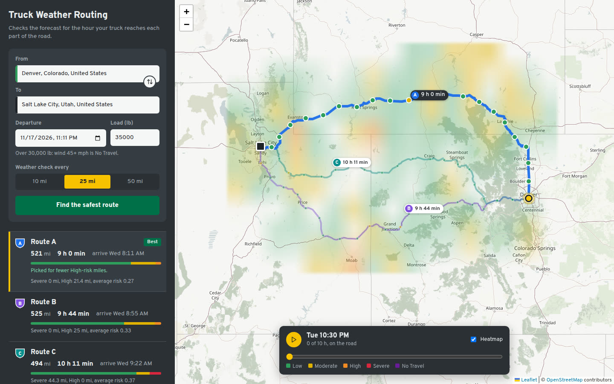

# Truck Weather Routing

React + Django app that picks the safest truck route using the weather at the time the truck reaches each part of the road.

- Live: https://spotter-ai.paramsavjani.in
- Walkthrough: https://www.loom.com/share/c4cc5be9138c4748b995672382d033e6
- Stack: Django 5, React 18 (Vite), Leaflet
- APIs (free, no keys): OSRM (routes), Open-Meteo (weather), Photon (place search)



## How it works

1. **Routes**: 3 routes from OSRM.
   - Two routes are different only if they share less than 70% of the road.
   - If OSRM gives fewer than 3, extra routes go through side points at 1/2, 1/3, 2/3 of the trip.
   - Extra routes over 1.5× the fastest are dropped.
2. **Checkpoints**: every 10 / 25 / 50 miles, plus the destination.
   - ETA uses OSRM's time for each road segment, not an average speed.
3. **Weather**: Open-Meteo hourly forecast at each checkpoint, for the hour the truck gets there.
4. **Risk**: worst of wind, rain and snow at each checkpoint (table below).
   - A stretch between two checkpoints counts at the worse of its two ends.
   - Gives miles per level and average risk (Low = 0 … No Travel = 4).
5. **Closed routes**: one No Travel checkpoint closes the route. It is never picked.
6. **Pick**: fewest Severe miles → fewest High miles → lowest average risk → shortest time. The reason is shown in the UI.
7. **All routes closed**: finds the earliest safe departure.
   - Moves the departure 1 hour at a time, up to 72 h.
   - Re-uses the forecast already fetched, so no extra API calls.
8. **Heatmap**: weather grid around the routes, one frame per hour until arrival (max 48 h).
   - All frames come in one response.
   - Each frame is drawn once as a small image, so the slider never calls the server.

## Risk rules

| Condition | Low | Moderate | High | Severe | No Travel |
|---|---|---|---|---|---|
| Wind (mph) | < 25 | 25–34 | 35–44 | 45–54 | ≥ 55 |
| Rain (in/h) | < 0.10 | 0.10–0.25 | 0.25–0.50 | 0.50–1.00 | > 1.00 |
| Snow (in/h) | < 0.5 | 0.5–1.0 | 1.0–2.0 | 2.0–3.0 | > 3.0 |

Load rules:
- 45–54 mph and load > 30,000 lb → No Travel
- 35–44 mph and load > 40,000 lb → Severe

Where ranges touch (e.g. rain 0.25), the higher level wins. No Travel for rain / snow starts above 1.00 / 3.0. Code: `backend/routing/risk.py`.

## API limits and caching

- Weather points are snapped to a 0.25° grid and de-duplicated.
- Forecasts are cached for 1 hour (file cache).
- On a 429 the call is retried once, then a clear error is shown.

## Project structure

```
backend/routing/
  risk.py        risk table and load rules
  providers.py   OSRM, Open-Meteo, Photon, route overlap, cache
  planner.py     checkpoints, scoring, pick, earliest departure, heatmap
  views.py       /api/plan/ and /api/geocode/
  tests.py       unit tests
frontend/src/
  App.jsx        app state
  api.js         API calls
  components/    TripForm, PlaceInput, Results, RouteMap, ForecastSlider, RouteShield
build.sh         builds the frontend into the backend
Dockerfile       one image: React build + Django
```

No database. Everything is computed per request.

## Run locally

Needs Python 3.12 and Node 18+.

```bash
python -m venv .venv
source .venv/bin/activate
pip install -r backend/requirements.txt
cd backend && python manage.py runserver
```

```bash
cd frontend
npm install
npm run dev
```

Open http://localhost:5173 (Vite proxies `/api` to port 8000).

## Tests

```bash
cd backend && python manage.py test routing
```

17 tests, no network calls:
- every risk threshold and load rule
- checkpoint spacing and ETA
- pick order, closed routes never picked
- earliest departure
- route overlap

## API

| Method | Path | Purpose |
|---|---|---|
| POST | `/api/plan/` | routes, checkpoints, risk, pick, heatmap |
| GET | `/api/geocode/?q=denver` | place suggestions |

```json
{
  "origin": { "label": "Denver, CO", "lat": 39.74, "lon": -104.99 },
  "destination": { "label": "Salt Lake City, UT", "lat": 40.76, "lon": -111.89 },
  "departure": "2026-11-17T08:00:00Z",
  "load_lbs": 42000,
  "interval_miles": 25
}
```

- `interval_miles`: 10, 25 or 50. `load_lbs`: up to 80,000. Departure: within 5 days.
- Errors: `400` for bad input, `502` if an outside API fails.
- Response: `routes`, `recommended_id`, `recommendation_reason`, `all_blocked`, `earliest_departure`, `heatmap`.

## Deploy

- `build.sh` builds React into `backend/frontend_build`; Django + WhiteNoise serves it.
- `render.yaml` works as a Render blueprint.
- Live demo runs in Docker behind Caddy:

```bash
docker build -t spotter-ai .
docker run -d --name spotter-ai -p 127.0.0.1:8010:8000 \
  -e DJANGO_SECRET_KEY=... -e DJANGO_ALLOWED_HOSTS=your.domain -v spotter-ai-cache:/data/cache spotter-ai
```

Env vars: `DJANGO_SECRET_KEY`, `DJANGO_DEBUG=0`, `DJANGO_ALLOWED_HOSTS`. Optional: `OSRM_URL`, `CACHE_DIR`, `CORS_ALLOWED_ORIGINS` / `VITE_API_URL` (only if frontend is hosted separately).

## Limitations

- OSRM uses a car profile, so no truck limits (height, weight).
- ETAs assume non-stop driving, no rest breaks.
- Times are in the viewer's timezone.
- Wind is sustained 10 m wind, not gusts.
- Earliest departure re-checks the same 3 routes; it does not search new ones.
